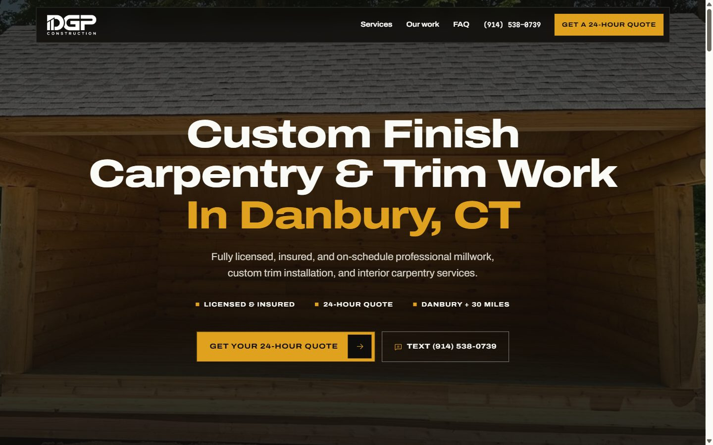
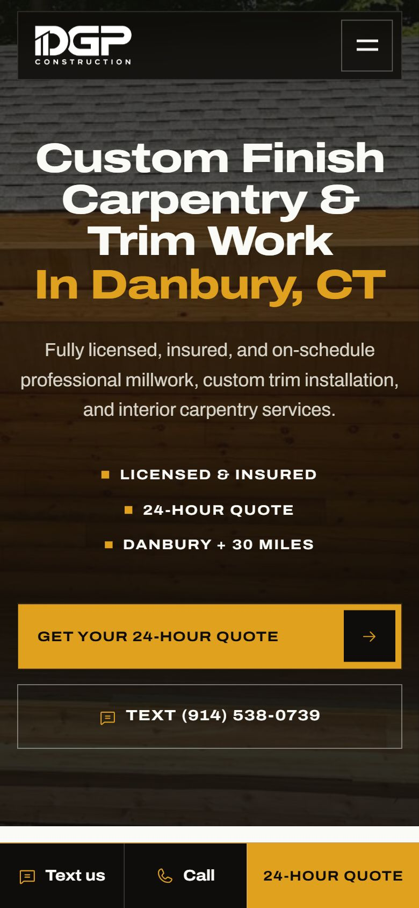

<div align="center">

<picture>
  <source media="(prefers-color-scheme: dark)" srcset="assets/img/DGP-LOGO-WHITE.webp">
  
</picture>

### Custom finish carpentry &amp; trim work in Danbury, CT

Site institucional one page da **DGP Construction LLC**, feito para transformar tráfego pago em pedidos de orçamento.

[](https://dgpconstructionusa.com)


**[dgpconstructionusa.com](https://dgpconstructionusa.com)**

</div>

<br>

<p align="center">
  
  &nbsp;
  
</p>

<br>

## Sobre o projeto

A DGP Construction é uma empresa de finish carpentry em Danbury, Connecticut, que atende um raio de 30 milhas (Fairfield County e Northern Westchester). O público é formado por proprietários de imóveis de 35 a 65 anos que chegam pelos anúncios, quase sempre pelo celular, e preferem SMS e e-mail a ligação.

O site tem um único objetivo: **levar o visitante a pedir o orçamento itemizado em 24 horas**. Cada seção termina apontando para o formulário, para o SMS ou para a ligação.

| | |
|---|---|
| **Cliente** | DGP Construction LLC |
| **Serviço principal** | Trim e finish carpentry |
| **Oferta** | Orçamento itemizado em até 24 horas |
| **Idioma do site** | Inglês americano |
| **Stack** | HTML, CSS e JavaScript puros, sem framework e sem etapa de build |
| **Hospedagem** | Hostinger (Apache) |

## Seções da página

| # | Seção | O que faz |
|:-:|---|---|
| 1 | **Hero** | Foto real em tela cheia, título em três linhas, provas rápidas e os dois CTAs (orçamento e SMS) |
| 2 | **About** | Fotos sobrepostas, texto curto e três selos com fatos declarados pelo cliente |
| 3 | **Reviews** | Cards escalonados com moldura de desenho técnico |
| 4 | **Services** | Seis cards com foto e overlay, o do meio de cada linha deslocado para baixo |
| 5 | **Why us** | Imagem de fundo com quatro motivos em cards |
| 6 | **Portfolio** | Seis fotos em duas linhas, a do meio deslocada |
| 7 | **FAQ** | Duas faixas de perguntas em rolagem contínua, com pausa no hover |
| 8 | **Quote** | Mapa do Google e formulário em três etapas (serviço, projeto, contato) |
| 9 | **Footer** | Marca, links, contato e crédito |

No celular, uma barra fixa no rodapé mantém **Text us**, **Call** e **24-hour quote** sempre à mão.

## Identidade visual

A direção é a de uma **prancha de desenho técnico de marcenaria**: linhas finas que passam das quinas, cruz de desenho nos cantos, grade quadriculada que se desfaz nas bordas de cada seção e o dourado da logo como cor de destaque.

| Cor | Token | Uso |
|---|---|---|
|  `#0E0D0B` | `--ink` | Texto, seções escuras, rodapé |
|  `#E0A11F` | `--gold` | Botões, destaques, marcadores |
|  `#F5C23E` | `--gold-hi` | Hover dos botões dourados |
|  `#865100` | `--gold-ink` | Texto dourado sobre fundo claro (contraste AA) |
|  `#FAFAF7` | `--paper` | Fundo das seções claras |

**Tipografia**, servida pelo próprio site (sem Google Fonts em produção):

- **Archivo** em largura expandida e peso 800 nos títulos, que conversa com as letras largas do "DGP".
- **Archivo** no texto corrido.
- **Martian Mono** apenas em rótulos e metadados.

Ícones da família **Phosphor**, num sprite SVG dentro do próprio HTML. O sistema completo está documentado em [DESIGN.md](DESIGN.md) e o contexto do cliente em [PRODUCT.md](PRODUCT.md).

## Estrutura

```text
.
├── index.html              página única
├── 404.html                página de erro no mesmo visual
├── privacy-policy.html     política de privacidade
├── terms-of-use.html       termos de uso
├── .htaccess               HTTPS sem www, cache, segurança, anti-spam, 404
├── robots.txt              libera indexação e aponta o sitemap
├── sitemap.xml             as três páginas públicas
├── site.webmanifest        nome, cores e ícones para instalar no celular
├── favicon.ico             16, 32 e 48 px
├── apple-touch-icon.png    ícone da tela inicial do iPhone (180 px)
├── humans.txt              quem fez o site
├── llms.txt                resumo do negócio para ferramentas de IA
├── assets/
│   ├── css/style.css       todos os estilos, tokens no :root
│   ├── js/main.js          menu, desenho animado, formulário em etapas
│   ├── fonts/              Archivo e Martian Mono (woff2, latin)
│   ├── icons/              favicon.svg e ícones 192, 512 e maskable
│   └── img/                logos, fotos reais, 2 imagens geradas e og-image.jpg
├── docs/
│   ├── images/GENERATED.json   registro das imagens geradas
│   └── readme/                 capturas usadas neste README
├── DESIGN.md               sistema visual
└── PRODUCT.md              contexto do cliente e do produto
```

## Rodando localmente

Não há dependências nem build. Qualquer servidor estático serve:

```bash
npx serve .
# ou
python -m http.server 8000
```

Abrir o `index.html` direto no navegador também funciona, mas a página 404 e os caminhos absolutos dela só respondem através de um servidor.

## Publicação (Hostinger)

Domínio: **https://dgpconstructionusa.com**

1. Use o zip de produção em `deploy/` (fica fora do git) ou envie os arquivos da lista abaixo.
2. No gerenciador de arquivos da Hostinger, abra a `public_html` do domínio e envie o conteúdo do pacote.
3. Ative o SSL do domínio. O `.htaccess` força HTTPS e leva `www` para o endereço sem `www`.
4. No Google Search Console, adicione o domínio e envie `https://dgpconstructionusa.com/sitemap.xml`.

**Vai para o servidor:** `index.html`, `404.html`, `privacy-policy.html`, `terms-of-use.html`, `.htaccess`, `robots.txt`, `sitemap.xml`, `site.webmanifest`, `favicon.ico`, `apple-touch-icon.png`, `humans.txt`, `llms.txt` e a pasta `assets/`.

O `.htaccess` cuida de:

- um único endereço canônico: HTTPS, sem `www`, e `/index.html` redirecionado para `/`;
- página 404 personalizada e bloqueio de listagem de pastas;
- bloqueio de arquivos ocultos e de projeto (`.md`, `.json`, `.csv`), deixando `/.well-known` livre para o certificado;
- anti-spam: bloqueia tentativas em `wp-login` e `xmlrpc` e requisições sem user agent;
- compressão gzip, cabeçalhos de segurança e cache longo para fontes, ícones e imagens.

### Anti-spam do formulário

O formulário tem um campo isca (`company`) invisível para pessoas e registra quando a página abriu (`form_started`). Se o campo isca vier preenchido ou o envio acontecer em menos de 4 segundos, o visitante vê a confirmação, mas nada é enviado. Quando o formulário for integrado, o servidor que recebe os pedidos precisa repetir as duas checagens.

## Pendências antes do lançamento

- [ ] **Depoimentos reais.** Os três atuais são exemplos e estão marcados no código.
- [x] **E-mail definitivo.** `dgpconstruction25@gmail.com`.
- [x] **Integração do formulário** (`form01`). Cada pedido vai em paralelo para o Web3Forms (e-mail) e para o webhook de leads da Eu Sou TS; a confirmação aparece se ao menos um aceitar, e se os dois falharem o visitante vê uma mensagem com o SMS. Envia `service`, `name`, `phone`, `email`, `town`, `message`, página, data e os parâmetros `utm_*`, `gclid` e `fbclid` da URL. As credenciais ficam em `assets/js/config.js`, que não é publicado neste repositório: para rodar o formulário, copie `assets/js/config.example.js` para `config.js` e preencha a chave do Web3Forms e a URL do webhook.
- [ ] **Link de avaliação do Google.** O botão *Share your experience* aponta para uma busca até o Google Business Profile existir.
- [x] **Política de privacidade e termos de uso.** Páginas `privacy-policy.html` e `terms-of-use.html`, linkadas no rodapé e no formulário. São um rascunho fiel ao que o site faz hoje; revisar com um advogado antes do lançamento.
- [ ] **Atualizar a política** quando o Meta Pixel ou a tag do Google Ads forem instalados, junto com um aviso de cookies. O formulário já dispara `generate_lead` e `Lead` automaticamente quando essas tags existirem.
- [ ] **Imagens geradas.** A imagem do card *Window Installation* e o fundo de *Why us* são ilustrativos, não obras da DGP. Substituir por fotos reais quando houver.

## Créditos

Fotografias das obras: arquivo da DGP Construction. Ícones: [Phosphor Icons](https://phosphoricons.com) (MIT). Fontes: [Archivo](https://fonts.google.com/specimen/Archivo) e [Martian Mono](https://fonts.google.com/specimen/Martian+Mono) (SIL OFL).

<br>

<div align="center">

Desenvolvido por **[Eu Sou TS](https://eusouts.com.br/)**

</div>
